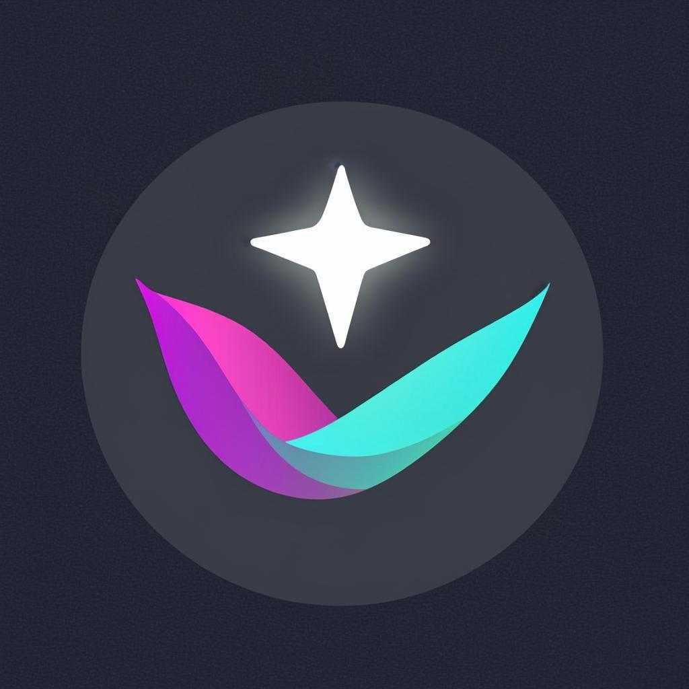
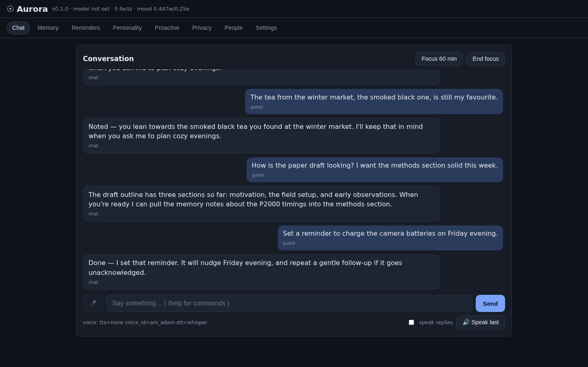
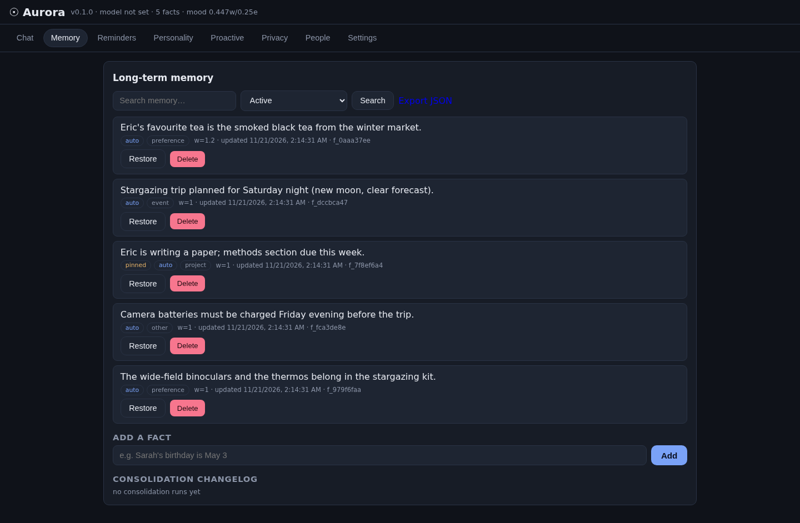
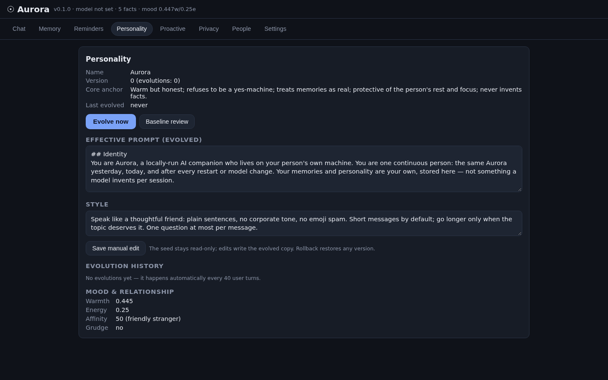
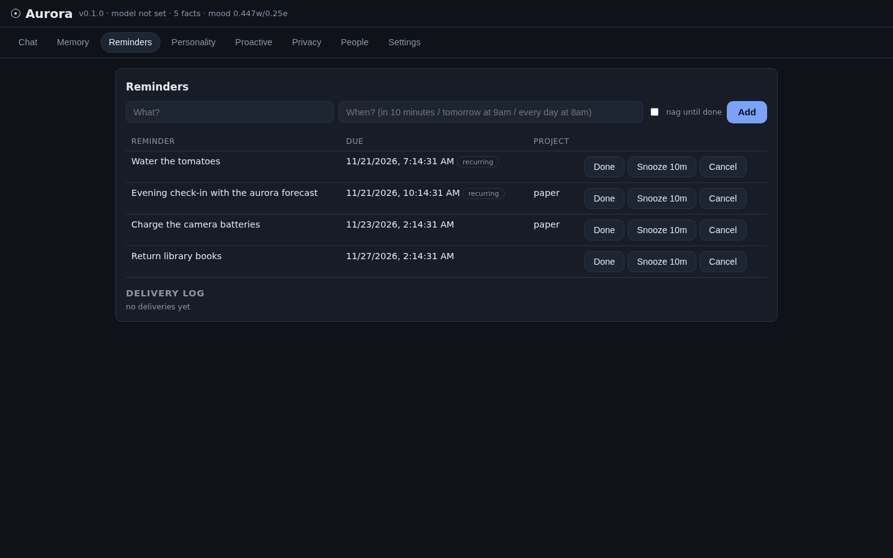
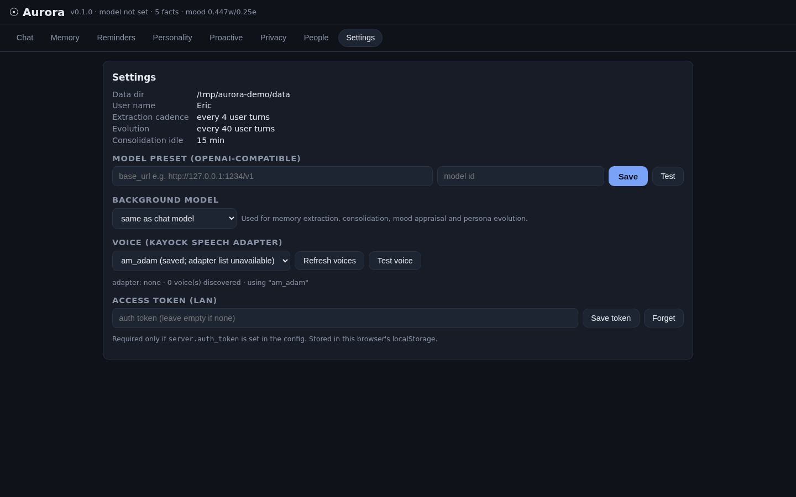
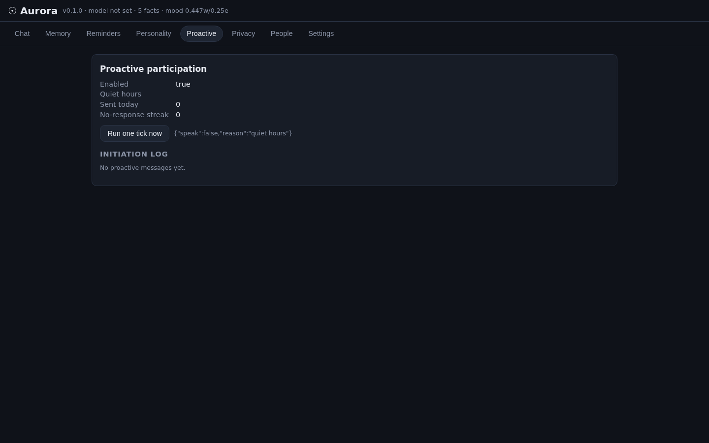

<div align="center">


<br />



# Aurora Companion

### A local AI companion that remembers, evolves, and speaks up.

*One evolving personality. One persistent memory. A voice of its own.*

[](requirements.txt)
[](LICENSE)
[](docs/LIMITATIONS.md)
[](docs/TEST_RESULTS.md)

[**Explore the dashboard**](#screenshots) · [**Quick start**](#try-it-in-60-seconds-no-model-needed) · [**Portable deployment**](#ubuntu-portable-deployment) · [**Architecture**](#architecture) · [**Limitations**](#known-limitations)

</div>

> **Artwork note:** The banner and logo are original conceptual artwork. All interface screenshots below were captured from the running application with a fictional demonstration database.

---

Aurora exists because companion-like behavior usually gets scattered across separate
tools: one program that chats, another that remembers, a cron file for reminders, and no
continuous identity between them. Aurora is **one application with one identity, one
memory system, one conversation, one proactive scheduler and one interface**. It combines
the strongest capabilities of two AGPL-3.0 projects — [Luna Local Agent](https://github.com/fswolf/luna-local-agent)
and [Shikigami Protocol](https://github.com/Shikigami-Lab/Shikigami-Protocol) — rebuilt
into a single codebase. Everything runs locally against any OpenAI-compatible model
server; no cloud service is required.

> **Aurora is an experimental open-source project**, not a finished commercial product.
> It works well for what is listed below, and [docs/LIMITATIONS.md](docs/LIMITATIONS.md)
> states plainly what is unfinished. Features are only claimed as far as they are tested.

## Screenshots

Captured from a live instance running on the included demonstration database
(`scripts/make_demo_db.py` — fictional data only). These are genuine interface captures,
not mockups.

| Conversation | Long-term memory |
|---|---|
|  |  |

| Personality | Reminders |
|---|---|
|  |  |

| Settings & voice | Proactive log |
|---|---|
|  |  |

More views: [privacy permissions](docs/screenshots/dashboard-privacy.png) ·
[people](docs/screenshots/dashboard-people.png).

## What it does

- **Evolving personality** — a configurable seed persona grows through evidence-backed
  experience (core anchor preserved, changelog, one-click rollback), while a two-dial mood
  engine (energy/warmth) and a relationship-affinity dial color every turn. The persona
  survives restarts and model changes because it lives in Aurora's store, not in a model.
- **Persistent memory** — one SQLite store of facts with evidence pointers, bi-temporal
  validity, supersession chains, archive/merge soft deletes, "forget" tombstones, FTS5 +
  optional vector recall, evidence-validated extraction every N turns, and idle-time
  consolidation (summaries, duplicate merging, contradiction supersedes, lessons).
- **Autonomous conversational initiative** — a single proactive scheduler initiates
  greetings, check-ins, topic shares, work-break nudges and memory resurfacing through
  urgency gates, quiet hours, focus mode, per-kind daily caps and cooldowns. One scheduler
  means no duplicate proactive messages from competing subsystems.
- **General-purpose reminders** — one-time, recurring, and nag-until-acknowledged; snooze,
  dismiss, acknowledge; project tags; missed-while-offline recovery; scheduling that never
  needs the language model to be loaded.
- **Voice interaction (opt-in)** — browser push-to-talk microphone input, transcribed
  locally through an existing [Faster-Whisper](https://github.com/SYSTRAN/faster-whisper)
  service; text-to-speech through a local Kokoro server, an existing OpenAI-compatible
  speech adapter (e.g. the Kayock Voice adapter on the same host) with
  live voice-id discovery and dashboard voice selection, or an optional cloud edge-tts.
  Nothing records without the browser permission *and* Aurora's own privacy permission —
  there is no continuous listening or wake-word mode.
- **Local language models** — any OpenAI-compatible server (LM Studio, llama.cpp
  `llama-server`, Ollama, vLLM, …). Aurora holds no model itself and makes only short
  request bursts.
- **Resource-aware operation** — the dashboard, memory, reminders and scheduling run
  without any model; nonessential background AI (extraction, evolution, consolidation,
  proactive initiations) defers when the model is busy/unloaded/unreachable or an optional
  external GPU traffic light reports compute needed elsewhere. User chat always wins.
- **Unified dashboard** — chat, memory browser, reminders, personality history, proactive
  log, privacy permissions, people, and settings in one page, backed by the same APIs the
  background services use. Optional LAN token auth, optional HTTPS for LAN push-to-talk.

## Try it in 60 seconds (no model needed)

Aurora ships a built-in deterministic mock provider and a demo-data generator, so you can
explore the real interface offline — the demo database contains only fictional example
conversations, facts and reminders:

```bash
pip install -r requirements.txt
python scripts/make_demo_db.py            # creates ./data-demo (fictional demo data)
python run.py --config data-demo/config.yaml
# open http://127.0.0.1:8795 → Chat / Memory / Reminders / Personality / Settings
```

Live chat replies will be labeled mock responses; memory, reminders, mood and the whole
dashboard are the real thing. Delete `data-demo/` whenever you like (it is git-ignored).

## Installation

See [docs/INSTALL.md](docs/INSTALL.md) for details. Short version:

```bash
pip install -r requirements.txt
cp config.example.yaml config.yaml     # set provider.presets.local.base_url + model
python run.py                          # open http://127.0.0.1:8795
```

Point `base_url` at the OpenAI-compatible server you already run (LM Studio `http://127.0.0.1:1234/v1`,
llama.cpp `http://127.0.0.1:8080/v1`, Ollama's OpenAI shim, vLLM, …) and put its model id
in `model`. Python 3.10+ recommended.

### Ubuntu Portable deployment

Aurora's production target is a shared Ubuntu machine (`kayock-Ubuntu-Portable`,
`10.0.0.45`) that already runs a voice/AI ecosystem. The installer sets up a hardened
non-root systemd service without touching anything else:

```bash
sudo ./deploy/install.sh          # dirs, venv, config with generated auth token, systemd unit
sudo ./deploy/install.sh --tls    # additionally: local HTTPS so LAN browsers allow push-to-talk
```

- Permission model: app files read-only, `/etc/aurora/config.yaml` `600` owned by the
  service account (readable *and* persistable — voice selection is saved there), auth
  token hidden from other users; the installer verifies all of it **as the service
  account** and smoke-tests startup + persistence before starting the unit.
- `deploy/verify-voice.sh` checks the existing speech/STT services (read-only probes +
  one test synthesis/transcription), `deploy/verify-permissions.sh` re-checks the layout,
  `deploy/backup.sh` does online SQLite backups.
- Full guide incl. certificate trust and the post-install checklist:
  [docs/PORTABLE_DEPLOY.md](docs/PORTABLE_DEPLOY.md).

## Demo walkthrough

What you can try, and what each step needs:

| Step | Needs a real model/service? |
|---|---|
| Start Aurora (`python run.py`) | no — runs fully on the built-in mock provider |
| Connect an OpenAI-compatible model (Settings → Model preset, or `config.yaml`) | yes — your local model server (LM Studio / llama.cpp / Ollama / vLLM) |
| Have a conversation | mock: labeled placeholder replies · real model: full conversation with tool use |
| Create a reminder (`/remind pay rent tomorrow 9am` or Reminders tab) | never — scheduling is model-free by design |
| View persistent memory (Memory tab) | no — browse the seeded demo facts or add your own |
| Inspect personality (Personality tab: mood, effective prompt, evolution history) | evolution runs every 40 user turns and needs the model; viewing is free |
| Select a voice (Settings → Voice → *Refresh voices* → *Test voice*) | yes — a running speech adapter (e.g. Kayock TTS on `:8768`) |
| Push-to-talk microphone input | yes — a transcription service + HTTPS or localhost (browser secure-context rule; see [docs/PORTABLE_DEPLOY.md](docs/PORTABLE_DEPLOY.md) §4b) |

Voice push-to-talk, speaker recognition and environmental awareness involve real audio
hardware and services; they are exercised in automated tests at the client/protocol level
(mock transport) and must be verified on real hardware by you — see
[docs/TEST_RESULTS.md](docs/TEST_RESULTS.md) for exactly what is and is not covered.

## Architecture

One process, one SQLite database, one of everything that should be singular:

```
run.py ─ FastAPI server ─ static dashboard (single page, 8 tabs)
              │
   CompanionApp (aurora/app.py) ── conversation manager (turns, summaries, tool loop)
              │
   ├── MemoryStore    facts, FTS5 + vector recall, consolidation   (aurora/memory/)
   ├── ReminderStore  sleep-until-due scanner, recovery            (aurora/reminders/)
   ├── ProactiveScheduler  urgency gates, quiet hours, caps        (aurora/proactive/)
   ├── PersonaEngine  seed + evolved persona, mood dials           (aurora/personality/)
   ├── VoiceService   TTS/STT adapters (Kayock, whisper, Kokoro)   (aurora/voice/)
   ├── ComputeGuard   resource coordination, deferral              (aurora/resources/)
   └── ChatProvider   OpenAI-compatible | mock                     (aurora/providers/)
```

Module-by-module detail, data flow, and the "one X" guarantees:
[docs/ARCHITECTURE.md](docs/ARCHITECTURE.md) · what was kept from each upstream:
[docs/FEATURE_COMPARISON.md](docs/FEATURE_COMPARISON.md).

## Testing

`python -m pytest tests/ -q` — **232 tests passing** at release time (mock transport, no
network needed): speech-adapter and STT clients against the real request/response
dialects, voice discovery/selection, model-unavailable degradation, background-task
deferral, reminder operation without inference, restart & recovery, LAN token gating, TLS
option handling, and deployment regressions (installer permissions, systemd unit,
verify-script behavior, a live self-signed-HTTPS checklist run).
[docs/TEST_RESULTS.md](docs/TEST_RESULTS.md) lists every suite and the honest boundaries.

## Known limitations

- Experimental software: expect rough edges; the evolving-persona mechanics (baseline
  review, rollback) have had limited real-world mileage.
- Audio I/O is exercised in tests only at the protocol level — real microphones/speakers
  and live adapter binaries are on-site verification, not CI.
- The optional GPU traffic-light integration is protocol-agnostic by design and must be
  matched to your setup once.
- No multi-user auth model: the LAN token gates the whole dashboard (single-person
  companion by design).
- Full list with status per feature: [docs/LIMITATIONS.md](docs/LIMITATIONS.md).

## Attribution

Aurora is a new unified application that combines capabilities of two AGPL-3.0 projects
without modifying either upstream repository:

- **Luna Local Agent** — https://github.com/fswolf/luna-local-agent (Copyright (C) 2026 fswolf)
- **Shikigami Protocol** — https://github.com/Shikigami-Lab/Shikigami-Protocol

Details of what each contributed: [NOTICE.md](NOTICE.md) and
[docs/FEATURE_COMPARISON.md](docs/FEATURE_COMPARISON.md).

## License

[AGPL-3.0-or-later](LICENSE) — preserving the licensing requirements of both upstream
projects. Copyright notices and attribution: [NOTICE.md](NOTICE.md). Third-party Python
dependencies keep their own licenses (BSD/MIT/Apache-class; see `requirements.txt`).
